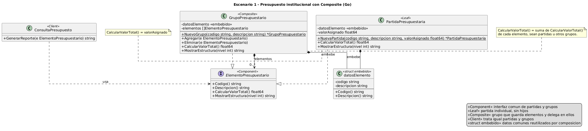

# Escenario 1 - Presupuesto jerárquico con Composite (Go)

## Contenido

1. [El problema estructural](#el-problema-estructural)
2. [Justificación](#justificación)
3. [Diagrama de clases](#diagrama-de-clases)
4. [Código fuente](#código-fuente)
5. [Uso crítico de inteligencia artificial](#uso-crítico-de-inteligencia-artificial)

## El problema estructural

El presupuesto forma una estructura de árbol en la que las partidas son los elementos simples y los
grupos son elementos compuestos que pueden contener partidas u otros grupos, con cualquier número de
niveles. El problema estructural es cómo organizar las clases para que partidas y grupos se manejen a
través de una misma abstracción, de modo que el cliente pueda calcular valores y mostrar la estructura
sin saber si está trabajando con un elemento individual o con una agrupación.

## Justificación

Se eligió el patrón Composite porque el presupuesto es una jerarquía parte-todo en la que un grupo
puede contener partidas y también otros grupos, y el escenario pide que ambos se traten de la misma
forma. Ese es el caso para el que existe este patrón: componer objetos en estructuras de árbol para
que el cliente trate igual a los elementos individuales y a las agrupaciones.

Con Composite, partidas y grupos comparten una misma abstracción. El cliente puede pedir el valor
total o la estructura de cualquier elemento sin saber de qué tipo es, y cada uno responde según lo que
representa: la partida devuelve su valor asignado y el grupo suma el de los elementos que contiene.

### Adaptación a Go

Go no tiene clases ni herencia, así que el diagrama y el código usan los mecanismos propios del
lenguaje:

- El **Component** es una `interface`. `PartidaPresupuestaria` y `GrupoPresupuestario` la cumplen de
  forma implícita, solo por tener los métodos, sin declarar `implements`.
- Los datos comunes (`codigo`, `descripcion`) y sus métodos de acceso están en el struct
  `datosElemento`, que se **embebe** en la hoja y en el compuesto. Como Go no tiene herencia, los
  datos comunes se reutilizan por composición.
- La visibilidad la da el nombre: con mayúscula es exportado (`+` en el UML) y con minúscula no lo es
  (`-`).
- Los constructores `NuevaPartida` y `NuevoGrupo` son funciones del paquete. En el UML aparecen como
  `{static}`.

### Participantes del patrón

| Participante | Tipo en Go | Responsabilidad |
|---|---|---|
| Component | `ElementoPresupuestario` (interface) | El elemento presupuestario. Es la abstracción común que comparten partidas y grupos, y define las operaciones que ambos deben ofrecer: obtener código y descripción, calcular el valor total y mostrar la estructura. |
| Leaf | `PartidaPresupuestaria` (struct) | La partida presupuestaria. Es el elemento individual del presupuesto, no contiene otros elementos y su valor total es su valor asignado. |
| Composite | `GrupoPresupuestario` (struct) | El grupo presupuestario. Contiene partidas u otros grupos, y su valor total es la suma de los valores de todos los elementos que contiene. |
| Client | `ConsultaPresupuesto` (struct) | La consulta del presupuesto. Trabaja con cualquier elemento a través de la abstracción común, sin distinguir si se trata de una partida o de un grupo. |

Tipo de apoyo: `datosElemento`, con los datos comunes que se embeben en partidas y grupos.

## Diagrama de clases

Fuente: [`uml/compositeE1_go.puml`](uml/compositeE1_go.puml).



| Relación | Notación | Significado |
|---|---|---|
| `PartidaPresupuestaria`, `GrupoPresupuestario` ⇢▷ `ElementoPresupuestario` | realización | ambos cumplen la interfaz, así el cliente no distingue entre partida y grupo |
| `PartidaPresupuestaria`, `GrupoPresupuestario` ◆— `datosElemento` («embebe») | composición por embebido | reutilizan código y descripción sin herencia |
| `GrupoPresupuestario` ◆→ `ElementoPresupuestario` (`1` → `0..*`, «elementos») | composición | el grupo contiene partidas u otros grupos; es la relación recursiva que forma el árbol |
| `ConsultaPresupuesto` ⇢ `ElementoPresupuestario` («usa») | dependencia | el cliente recibe un Component por parámetro |

Decidimos que `Agregar` y `Eliminar` queden solo en `GrupoPresupuestario`: una partida no tiene hijos
y no debería ofrecer esas operaciones.

El código es deliberadamente mínimo, porque su fin es educativo: muestra solo el patrón, sin
validaciones ni manejo de errores.

## Código fuente

Requiere Go 1.25 o superior.

```text
codigo/
├── go.mod                                  # módulo presupuesto-composite
├── cmd/presupuesto/main.go                 # demostración con el ejemplo del enunciado
└── composite/
    ├── elemento.go                         # ElementoPresupuestario (Component) y datosElemento
    ├── partida.go                          # PartidaPresupuestaria (Leaf)
    ├── grupo.go                            # GrupoPresupuestario (Composite)
    ├── consulta.go                         # ConsultaPresupuesto (Client)
    ├── composite_test.go                   # pruebas de comportamiento
    └── correspondencia_uml_codigo_test.go  # el UML como contrato
```

Ejecución (desde `codigo/`):

```text
go test ./...
go run ./cmd/presupuesto
```

Salida de la demostración:

```text
[TI] Tecnologias de la Informacion: 105000.00
  [TI-01] Licenciamiento: 20000.00
  [TI-INF] Infraestructura: 72500.00
    [TI-INF-01] Servidores: 45000.00
    [TI-INF-02] Almacenamiento: 18000.00
    [TI-INF-03] Comunicaciones: 9500.00
  [TI-02] Servicios: 12500.00
Total: 105000.00
```

### Correspondencia UML ↔ código

`TestCorrespondenciaUmlCodigo` lee `uml/compositeE1_go.puml` y analiza el paquete con `go/ast`. La
prueba falla si el diagrama y el código no tienen los mismos tipos, campos (incluidos los embebidos)
y métodos con su firma completa, o si cambian las realizaciones de la interfaz.

Si se cambia el código, hay que actualizar el `.puml` y regenerar la imagen.

## Uso crítico de inteligencia artificial

### Prompt principal

> "Eres un experto arquitecto de software. Se te presenta este escenario: una institución necesita
> representar su presupuesto en niveles jerárquicos, con partidas individuales y grupos que pueden
> contener partidas u otros grupos. Ambos deben permitir obtener su código y descripción, calcular su
> valor total y mostrar su estructura, sin que el cliente tenga que distinguir entre uno y otro.
> Además, la estructura debe poder crecer sin modificar la lógica que la consulta. Debes dar una
> recomendación del patrón estructural más adecuado con su justificación e identificar sus
> participantes."

### Recomendación aceptada (con justificación)

Recomiendo el patrón Composite, porque el presupuesto es una jerarquía parte-todo en la que los grupos
pueden contener partidas y otros grupos. Composite define una abstracción común para ambos, así que el
cliente puede consultar el valor total o la estructura de cualquier elemento sin saber si es una
partida o un grupo. La partida devuelve su valor asignado y el grupo suma recursivamente el de sus
elementos. Además, se pueden agregar nuevos niveles sin modificar la lógica que consulta el
presupuesto.

### Recomendación modificada o rechazada (con justificación)

Las alternativas al Composite serían:

- **Condicionales sobre el tipo:** el cliente distingue entre partida y grupo. Es simple, pero queda
  acoplado a los tipos concretos y hay que modificarlo cada vez que cambia la estructura.
- **Decorator:** envuelve un solo objeto para agregarle comportamiento, así que no sirve para un grupo
  con varios elementos.
- **Visitor:** permite añadir operaciones nuevas sin modificar las clases. Complementa al Composite,
  pero para tres operaciones es más complejidad de la necesaria.
- **Iterator:** da un recorrido uniforme de la estructura, pero no representa la jerarquía ni calcula
  los valores, así que también es un complemento y no una alternativa.
