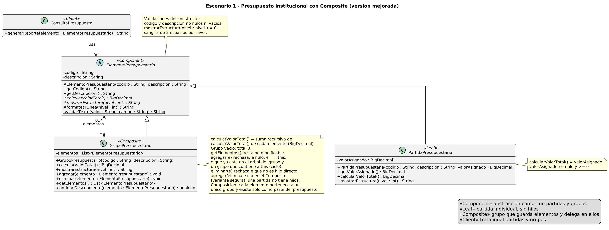

# Escenario 1 - Presupuesto jerárquico con Composite

## Contenido

1. [El problema estructural](#el-problema-estructural)
2. [Patrón seleccionado](#patrón-seleccionado)
3. [Justificación](#justificación)
4. [Supuestos de diseño](#supuestos-de-diseño)
5. [Diagrama de clases](#diagrama-de-clases)
6. [Consecuencias del patrón](#consecuencias-del-patrón)
7. [Código fuente](#código-fuente)
8. [Uso crítico de inteligencia artificial](#uso-crítico-de-inteligencia-artificial)

## El problema estructural

El presupuesto forma una estructura de árbol: las partidas son los elementos simples y los grupos son
elementos compuestos que pueden contener partidas u otros grupos, con cualquier número de niveles. El
problema estructural es cómo organizar las clases para que partidas y grupos se manejen a través de una
misma abstracción, de modo que el cliente pueda calcular valores y mostrar la estructura sin saber si
trabaja con un elemento individual o con una agrupación, y que la estructura pueda crecer con nuevos
niveles sin modificar la lógica que la consulta.

## Patrón seleccionado

**Composite** (patrón estructural, GoF).

### Participantes del patrón

| Participante | Clase | Responsabilidad |
|---|---|---|
| Component | `ElementoPresupuestario` (abstracta) | Abstracción común: código, descripción, `calcularValorTotal()` y `mostrarEstructura(nivel)`. Valida código y descripción. |
| Leaf | `PartidaPresupuestaria` | Partida individual sin hijos; su valor total es el valor asignado. |
| Composite | `GrupoPresupuestario` | Guarda partidas u otros grupos, suma recursivamente sus valores, gestiona `agregar`/`eliminar` y evita ciclos. |
| Client | `ConsultaPresupuesto` | Genera el reporte de cualquier `ElementoPresupuestario` sin distinguir su tipo. |

## Justificación

Se eligió Composite porque el presupuesto es una jerarquía parte-todo en la que un grupo puede contener
partidas y también otros grupos, y el escenario pide que ambos se traten de la misma forma. Ese es el
caso para el que existe este patrón: componer objetos en estructuras de árbol para que el cliente trate
igual a los elementos individuales y a las agrupaciones.

Con Composite, partidas y grupos comparten una misma abstracción. El cliente pide el valor total o la
estructura de cualquier elemento sin saber de qué tipo es, y cada uno responde según lo que representa:
la partida devuelve su valor asignado y el grupo suma el de los elementos que contiene. Un nivel nuevo
de agrupación es solo otro `GrupoPresupuestario` dentro del árbol, así que `ConsultaPresupuesto` no
cambia (lo comprueba la prueba `nuevoNivelSinModificarElCliente`).

### Variante segura: `agregar` y `eliminar` solo en el grupo

GoF describe dos variantes. En la *transparente*, `agregar` y `eliminar` se declaran en el Component y
la hoja las implementa lanzando una excepción; en la *segura*, solo el Composite las tiene. Elegimos la
**variante segura**: una partida no tiene hijos, y si ofreciera `agregar` el error aparecería en
ejecución en lugar de en compilación. El costo es que, para construir el árbol, el código que arma el
presupuesto (aquí `Demo` y las pruebas) trabaja con el tipo `GrupoPresupuestario`. Las operaciones de
consulta, que son las que pide el enunciado, siguen siendo uniformes.

### Composición entre grupo y elementos

El diagrama usa composición (rombo lleno, `1` → `0..*`). El ciclo de vida que la sostiene es este:

- Una partida o un grupo existe dentro del presupuesto solo como parte de un grupo (o como raíz); no
  tiene sentido presupuestario por sí sola fuera de esa estructura.
- Cada elemento pertenece a **un único grupo**. `agregar` rechaza un elemento que ya está en el árbol
  del grupo, de modo que un mismo objeto no se cuenta dos veces.
- Al `eliminar` un elemento, sale del presupuesto: el grupo deja de referenciarlo y deja de sumarse.
- Si se descarta un grupo, se descarta con él todo su subárbol.

Java no destruye objetos explícitamente; la composición se expresa como propiedad exclusiva y no como
control de memoria. La regla de pertenencia única se valida dentro del árbol de cada grupo; ver
supuestos.

### Validaciones

- Código y descripción: no nulos ni vacíos (`ElementoPresupuestario`).
- Valor asignado: no nulo y no negativo; el cero está permitido (`PartidaPresupuestaria`).
- `getElementos()` devuelve una vista no modificable (`Collections.unmodifiableList`).
- `agregar` rechaza: `null`, el propio grupo, un elemento que ya está en el árbol del grupo y un grupo
  que contiene a este (ciclo). `eliminar` rechaza un elemento que no es hijo directo.
- `mostrarEstructura(nivel)` rechaza niveles negativos.

Todas lanzan `IllegalArgumentException` con mensajes en ASCII.

## Supuestos de diseño

Supuestos que el enunciado no define. Los propuso la IA durante la corrección y el grupo debe confirmarlos
`[COMPLETAR POR EL GRUPO: confirmar o ajustar]`:

1. Los valores son montos en una sola moneda; se usa `BigDecimal` para evitar errores de redondeo y la
   estructura muestra dos decimales (redondeo `HALF_UP`) solo al presentar.
2. Un grupo vacío es válido y vale cero.
3. `mostrarEstructura` usa dos espacios de sangría por nivel y el formato `codigo descripcion: total`.
4. La regla «un elemento pertenece a un único grupo» se verifica dentro del árbol del grupo que recibe
   el elemento. Si se usa el mismo objeto en dos árboles separados, el código no lo detecta (no se
   guarda una referencia al padre para mantener el diseño simple).
5. Los valores de `Demo` son ilustrativos.

## Diagrama de clases

Fuente: [`uml/compositeE1_mejorado.puml`](uml/compositeE1_mejorado.puml). La versión anterior
(`compositeE1.puml`) se conserva en el historial de git.



| Relación | Notación | Significado |
|---|---|---|
| `ElementoPresupuestario` ← `PartidaPresupuestaria`, `GrupoPresupuestario` | herencia | partidas y grupos comparten la misma abstracción, así el cliente no distingue entre ambos |
| `GrupoPresupuestario` ◆→ `ElementoPresupuestario` (`1` → `0..*`, `elementos`) | composición | el grupo es dueño exclusivo de sus elementos; es la relación recursiva que forma el árbol |
| `ConsultaPresupuesto` ⇢ `ElementoPresupuestario` («usa») | dependencia | el cliente recibe un Component por parámetro y no sabe si es partida o grupo |

Cambios respecto de la primera versión: constructores en las tres clases del árbol, getter
`getValorAsignado()`, método `formatearLinea` (sangría común) y `validarTexto`, método privado
`contieneDescendiente` para detectar ciclos, y notas con las validaciones, la vista no modificable, la
variante segura y la justificación de la composición.

## Consecuencias del patrón

**Ventajas**

- El cliente es simple: `ConsultaPresupuesto.generarReporte` trata partidas y grupos con el mismo código, sin `instanceof`.
- Agregar niveles o nuevos tipos de elemento no obliga a cambiar el cliente (principio abierto/cerrado).
- El cálculo recursivo queda en el lugar natural: cada grupo suma a sus hijos.

**Límites**

- El diseño se vuelve muy general: el tipo `ElementoPresupuestario` no impide, por sí mismo, estructuras
  que el negocio no quiera (por ejemplo, limitar la profundidad o qué puede contener cada grupo); esas
  reglas hay que validarlas aparte.
- Hay que decidir dónde van `agregar` y `eliminar`. Con la variante segura se pierde transparencia al
  construir el árbol; con la transparente, la hoja tendría operaciones que no tienen sentido.

**Riesgos**

- Ciclos o elementos repetidos producirían recursión infinita o doble conteo; por eso `agregar` los valida.
- En árboles muy profundos la recursión podría agotar la pila; no es un caso realista para un presupuesto.
- Recalcular el total en cada llamada es O(n); si el árbol fuera grande y se consultara mucho, convendría guardar en caché los totales.

## Código fuente

- Código: [`codigo/src/main/java/ec/edu/ups/pds/composite`](codigo/src/main/java/ec/edu/ups/pds/composite)
- Pruebas: [`codigo/src/test/java/ec/edu/ups/pds/composite`](codigo/src/test/java/ec/edu/ups/pds/composite)
- Manual de uso (compilar, probar, ejecutar la demo): [`codigo/README.md`](codigo/README.md)
- Trazabilidad UML-código: [`docs/trazabilidad-uml-codigo.md`](docs/trazabilidad-uml-codigo.md)

## Uso crítico de inteligencia artificial

> Borrador. Todo lo marcado con `[COMPLETAR POR EL GRUPO]` depende de lo que el grupo realmente hizo y
> debe editarse antes de la entrega. No se debe presentar como ocurrido algo que no ocurrió.

### Prompt principal

**Prompt original** (el que figura en la primera versión del PDF): pedía a la IA, como «experto
arquitecto de software», recomendar el patrón más adecuado y sus participantes a partir del enunciado.
El problema de ese prompt es que delega en la IA la decisión que la actividad evalúa en el grupo.

**Prompt mejorado** (propuesto; `[COMPLETAR POR EL GRUPO: indicar si se usó, con qué herramienta y en qué fecha]`):

```text
Somos un grupo de maestría que resolvió el siguiente escenario con el patrón Composite.
Te entregamos el enunciado y nuestro diagrama de clases en PlantUML:

<enunciado del escenario 1>
<contenido de uml/compositeE1_mejorado.puml>

No elijas el patrón: ya lo elegimos. Queremos que revises nuestro diseño.
1. Antes de opinar, haznos las preguntas de aclaración que necesites sobre supuestos que el
   diagrama no define (montos, grupos vacíos, elementos compartidos, formato de la estructura).
2. Señala errores o inconsistencias del UML: multiplicidades, tipo de relación (composición o
   agregación), visibilidad, constructores y validaciones que falten.
3. Indica riesgos de la implementación: ciclos, elementos repetidos, exposición de la lista
   interna, precisión de los montos.
4. Para cada observación explica por qué y qué cambiarías en el diagrama.
No generes código todavía.
```

### Recomendación aceptada

**Dejar `agregar` y `eliminar` solo en `GrupoPresupuestario` (variante segura).**
`[COMPLETAR POR EL GRUPO: confirmar que esta recomendación vino de la IA y en qué momento; si no, reemplazarla por la que sí se aceptó]`

Justificación: una partida no tiene hijos; si el Component declarara `agregar`, la partida tendría que
lanzar una excepción y el error se detectaría en ejecución. Con la variante segura el compilador impide
agregar elementos a una partida. Aceptamos el costo de que quien arma el árbol use el tipo concreto
`GrupoPresupuestario`, porque el enunciado exige uniformidad en las operaciones de consulta, no en la
construcción.

### Recomendación modificada o rechazada

**La IA recomendó cambiar la composición por agregación; el grupo la rechazó y mantuvo la composición.**

Lo que ocurrió: durante la corrección (22/10/2026, con Claude Code), la IA recomendó dibujar la relación
grupo → elementos como agregación, con el argumento de que los elementos se crean fuera del grupo y se
pasan a `agregar()`. El grupo respondió que en Composite la relación es de composición y la mantuvo.
`[COMPLETAR POR EL GRUPO: ampliar o corregir con su propio razonamiento]`

Justificación: en el dominio, una partida o un subgrupo existe en el presupuesto solo como parte de un
grupo y pertenece a uno solo; al eliminarlo sale del presupuesto. Que el objeto se cree fuera y luego se
pase al grupo es un detalle de construcción, no de ciclo de vida. Para que la decisión sea coherente con
el código, el grupo exigió que `agregar` rechace elementos ya presentes en el árbol, y dejó documentado
el límite en los supuestos (no se detecta el mismo objeto en dos árboles separados).
