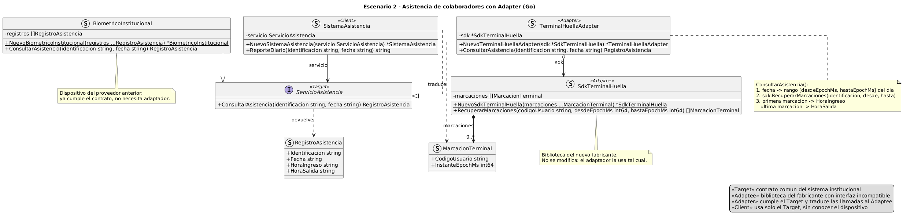

# Escenario 2 - Asistencia de colaboradores con Adapter (Go)

## Contenido

1. [El problema estructural](#el-problema-estructural)
2. [Justificación](#justificación)
3. [Diagrama de clases](#diagrama-de-clases)
4. [Código fuente](#código-fuente)
5. [Uso crítico de inteligencia artificial](#uso-crítico-de-inteligencia-artificial)

## El problema estructural

El problema estructural es una incompatibilidad de interfaces: el sistema institucional espera
consultar la asistencia mediante su contrato común, pero la biblioteca del nuevo fabricante ofrece
operaciones y datos distintos. Como no se puede modificar ninguno de los dos, hay que hacerlos
trabajar juntos sin cambiarlos.

## Justificación

Se eligió el patrón Adapter porque su propósito es permitir que dos componentes con interfaces
incompatibles trabajen juntos sin modificar ninguno de ellos. El sistema institucional necesita
mantener estable su contrato y la biblioteca del fabricante no puede cambiarse.

Se descartó modificar el sistema para usar directamente la nueva biblioteca, porque lo haría
dependiente del proveedor. También se descartó modificar la biblioteca, porque se perdería
compatibilidad con sus actualizaciones.

### Adaptación a Go

Go no tiene clases ni herencia, así que el diagrama y el código usan los mecanismos propios del
lenguaje:

- El **Target** es una `interface`. `TerminalHuellaAdapter` y `BiometricoInstitucional` la cumplen de
  forma implícita, solo por tener el método `ConsultarAsistencia`, sin declarar `implements`.
- El adaptador es un **adaptador de objetos**: guarda al SDK del fabricante en el campo `sdk` y le
  delega las llamadas. Es composición; Go no permite la variante de clase, que hereda del adaptado.
- La visibilidad la da el nombre: con mayúscula es exportado (`+` en el UML) y con minúscula no lo es
  (`-`).
- Los constructores `NuevoX` son funciones del paquete. En el UML aparecen como `{static}`.

### Participantes del patrón

| Participante | Tipo en Go | Responsabilidad |
|---|---|---|
| Target | `ServicioAsistencia` (interface) | El servicio de asistencia. Es el contrato común que ya usa el sistema institucional para consultar la asistencia de un colaborador en una fecha y recibir datos normalizados. |
| Adaptee | `SdkTerminalHuella` (struct) | La biblioteca del nuevo fabricante. Ofrece sus propias operaciones y tipos de datos, devuelve una colección de marcaciones y no puede modificarse. |
| Adapter | `TerminalHuellaAdapter` (struct) | El adaptador del nuevo dispositivo. Implementa el contrato del sistema y traduce cada consulta a la biblioteca del fabricante. |
| Client | `SistemaAsistencia` (struct) | El sistema de asistencia. Trabaja solo con el contrato común y no sabe qué dispositivo hay detrás. |

Tipos de apoyo:

- `RegistroAsistencia`: los datos normalizados que espera el sistema (identificación, fecha, hora de
  ingreso y hora de salida).
- `MarcacionTerminal`: el tipo de dato propio del fabricante (código de usuario e instante en
  milisegundos).
- `BiometricoInstitucional`: el dispositivo del proveedor anterior, que ya cumple el contrato y no
  necesita adaptador.

## Diagrama de clases

Fuente: [`uml/adapterE2_go.puml`](uml/adapterE2_go.puml).



| Relación | Notación | Significado |
|---|---|---|
| `TerminalHuellaAdapter`, `BiometricoInstitucional` ⇢▷ `ServicioAsistencia` | realización | ambos cumplen el contrato, así el cliente no distingue entre dispositivos |
| `SistemaAsistencia` → `ServicioAsistencia` («servicio») | asociación | el cliente guarda y usa solo el Target |
| `TerminalHuellaAdapter` ◇→ `SdkTerminalHuella` («sdk») | agregación | el adaptador contiene al adaptado y le delega las llamadas (adaptador de objetos) |
| `SdkTerminalHuella` ◆→ `MarcacionTerminal` (`0..*`, «marcaciones») | composición | la biblioteca guarda sus marcaciones |
| `ServicioAsistencia` ⇢ `RegistroAsistencia` («devuelve») | dependencia | el contrato devuelve los datos normalizados |
| `TerminalHuellaAdapter` ⇢ `MarcacionTerminal` («traduce») | dependencia | el adaptador recibe marcaciones y las convierte en un registro |

La traducción que hace `ConsultarAsistencia` en el adaptador:

| Sistema institucional (Target) | Biblioteca del fabricante (Adaptee) |
|---|---|
| `ConsultarAsistencia(identificacion, fecha)` | `RecuperarMarcaciones(codigoUsuario, desdeEpochMs, hastaEpochMs)` |
| `identificacion` | `codigoUsuario` |
| `fecha` (`AAAA-MM-DD`) | rango del día en milisegundos: desde las 00:00:00.000 hasta las 23:59:59.999 |
| `RegistroAsistencia.HoraIngreso` (`HH:MM`) | primera marcación del día |
| `RegistroAsistencia.HoraSalida` (`HH:MM`) | última marcación del día |

El código es deliberadamente mínimo, porque su fin es educativo: muestra solo el patrón, sin
validaciones ni manejo de errores. Para simplificar, la fecha se asume válida y las horas se expresan
en UTC.

## Código fuente

Requiere Go 1.25 o superior.

```text
codigo/
├── go.mod                                  # módulo asistencia-adapter
├── cmd/asistencia/main.go                  # demostración con ambos dispositivos
└── adapter/
    ├── servicio.go                         # ServicioAsistencia (Target) y RegistroAsistencia
    ├── biometrico_institucional.go         # BiometricoInstitucional (proveedor anterior)
    ├── sdk_terminal_huella.go              # SdkTerminalHuella (Adaptee) y MarcacionTerminal
    ├── terminal_huella_adapter.go          # TerminalHuellaAdapter (Adapter)
    ├── sistema_asistencia.go               # SistemaAsistencia (Client)
    ├── adapter_test.go                     # pruebas de comportamiento
    └── correspondencia_uml_codigo_test.go  # el UML como contrato
```

Ejecución (desde `codigo/`):

```text
go test ./...
go run ./cmd/asistencia
```

Salida de la demostración: el mismo `SistemaAsistencia` consulta el dispositivo anterior y el nuevo,
este último a través del adaptador.

```text
Dispositivo anterior: 0102030405 | 2026-10-22 | ingreso 08:00 | salida 17:00
Dispositivo nuevo:    0607080910 | 2026-10-22 | ingreso 08:05 | salida 17:10
```

### Correspondencia UML ↔ código

`TestCorrespondenciaUmlCodigo` lee `uml/adapterE2_go.puml` y analiza el paquete con `go/ast`. La
prueba falla si el diagrama y el código no tienen los mismos tipos, campos y métodos con su firma
completa, o si cambian las realizaciones de la interfaz.

Si se cambia el código, hay que actualizar el `.puml` y regenerar la imagen.

## Uso crítico de inteligencia artificial

### Prompt principal

> "Eres un experto arquitecto de software. Se te presenta este escenario: una universidad tiene un
> sistema de asistencia que consulta los registros de un colaborador en una fecha mediante un contrato
> común y espera datos normalizados (identificación, fecha, hora de ingreso y hora de salida). La
> universidad adquirió dispositivos biométricos de un nuevo fabricante, cuya biblioteca no puede
> modificarse y tiene operaciones, parámetros y tipos de datos distintos, ya que devuelve una
> colección de marcaciones en lugar de la asistencia diaria. El sistema debe mantener su contrato
> estable, no depender del proveedor y permitir incorporar equipos de otros fabricantes en el futuro.
> Debes dar una recomendación del patrón estructural más adecuado con su justificación e identificar
> sus participantes."

### Recomendación aceptada (con justificación)

Recomiendo usar un adaptador de objetos, es decir, que el adaptador contenga a la biblioteca del
fabricante y le delegue las llamadas en lugar de heredar de ella. Como la biblioteca no puede
modificarse y podría cambiar en futuras versiones, conviene depender lo menos posible de su
implementación interna. Así, el adaptador solo usa sus operaciones públicas y el sistema sigue
trabajando únicamente con su contrato común. Si en el futuro se incorporan equipos de otros
proveedores, basta con crear un adaptador nuevo para cada uno sin modificar el resto de la
aplicación.

### Recomendación modificada o rechazada (con justificación)

- **Facade:** simplifica el acceso a un subsistema, pero no adapta la biblioteca a un contrato que ya
  existe.
- **Bridge:** separa abstracción e implementación desde el diseño inicial, y aquí ambos componentes ya
  existen.
- **Decorator:** agrega comportamiento manteniendo la misma interfaz, pero el problema es traducir una
  interfaz distinta.
