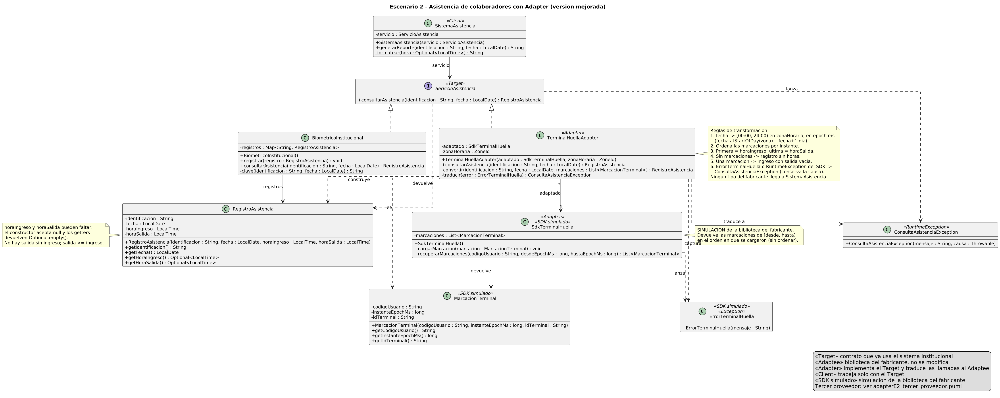
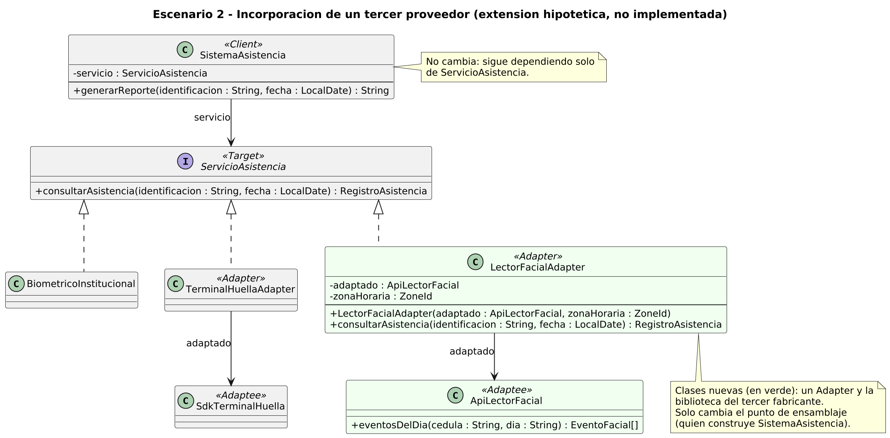

# Escenario 2 - Asistencia biométrica con Adapter

## Contenido

1. [El problema estructural](#el-problema-estructural)
2. [Patrón seleccionado](#patrón-seleccionado)
3. [Justificación](#justificación)
4. [Reglas de transformación](#reglas-de-transformación)
5. [Supuestos de diseño](#supuestos-de-diseño)
6. [Diagrama de clases](#diagrama-de-clases)
7. [Incorporar un tercer proveedor](#incorporar-un-tercer-proveedor)
8. [Consecuencias del patrón](#consecuencias-del-patrón)
9. [Código fuente](#código-fuente)
10. [Uso crítico de inteligencia artificial](#uso-crítico-de-inteligencia-artificial)

## El problema estructural

Es una incompatibilidad de interfaces. El sistema institucional consulta la asistencia mediante su
contrato común (identificación + fecha → registro con hora de ingreso y de salida), pero la biblioteca
del nuevo fabricante ofrece otra operación, otros parámetros (código de usuario y un rango en
milisegundos) y otro resultado (una colección de marcaciones sueltas). No se puede modificar ninguno de
los dos: cambiar el sistema lo ataría al proveedor, y cambiar la biblioteca rompería la compatibilidad
con sus versiones futuras. Además, podrían llegar otros proveedores con interfaces distintas.

## Patrón seleccionado

**Adapter de objetos** (patrón estructural, GoF): una clase implementa el contrato que espera el
sistema y, por composición, delega en la biblioteca del fabricante, transformando parámetros, resultados
y errores.

### Participantes del patrón

| Participante | Clase o interfaz | Responsabilidad |
|---|---|---|
| Target | `ServicioAsistencia` | Contrato que ya usa el sistema: `consultarAsistencia(identificacion, fecha)`. |
| Adaptee | `SdkTerminalHuella` (simulación) | Biblioteca del fabricante: `recuperarMarcaciones(codigoUsuario, desdeEpochMs, hastaEpochMs)`. No se modifica. |
| Adapter | `TerminalHuellaAdapter` | Implementa el Target, convierte la fecha en rango, ordena y transforma marcaciones y traduce errores. |
| Client | `SistemaAsistencia` | Genera reportes usando solo `ServicioAsistencia`. |
| (Target existente) | `BiometricoInstitucional` (simulación) | Proveedor anterior que ya cumple el contrato. |
| (Datos del Target) | `RegistroAsistencia`, `ConsultaAsistenciaException` | Resultado normalizado y error del dominio. |
| (Datos del Adaptee) | `MarcacionTerminal`, `ErrorTerminalHuella` (simulación) | Tipos propios del fabricante; no salen del adaptador. |

## Justificación

Se eligió Adapter porque su propósito es permitir que dos componentes con interfaces incompatibles
trabajen juntos sin modificar ninguno de ellos. El sistema institucional necesita mantener estable su
contrato y la biblioteca del fabricante no puede cambiarse. Se descartó modificar el sistema para usar
directamente la nueva biblioteca, porque lo haría dependiente del proveedor, y modificar la biblioteca,
porque se perdería compatibilidad con sus actualizaciones.

**Adaptador de objetos y no de clase.** El adaptador de clase heredaría de `SdkTerminalHuella` e
implementaría `ServicioAsistencia`. Lo descartamos porque:

- expondría al cliente todos los métodos públicos del SDK a través del adaptador;
- ataría el adaptador a la implementación concreta de la biblioteca (herencia), justo lo que el escenario
  quiere evitar ante versiones futuras;
- con composición, el SDK se inyecta por el constructor y en las pruebas se puede sustituir por una
  versión que falla, sin tocar el adaptador.

**Inyección por constructor.** `TerminalHuellaAdapter(SdkTerminalHuella, ZoneId)` recibe la biblioteca y
la zona horaria. La zona es un dato del contexto institucional (no del colaborador ni del dispositivo) y
es necesaria para convertir una fecha local en un rango de instantes.

## Reglas de transformación

Están implementadas en `TerminalHuellaAdapter` y documentadas en su Javadoc y en el UML.

| # | Regla | Prueba |
|---|---|---|
| 1 | La fecha se convierte al rango `[00:00, 24:00)` de la zona horaria, en milisegundos: desde `fecha.atStartOfDay(zona)` hasta el inicio del día siguiente (el fin es exclusivo; cubre cambios de horario). | `bordeDeZonaHoraria`, `laZonaHorariaDefineElDia` |
| 2 | Se ordenan las marcaciones por instante (el SDK no garantiza orden). | `variasMarcacionesDesordenadas` |
| 3 | La primera marcación es la hora de ingreso y la última, la hora de salida; las intermedias se ignoran. | `variasMarcacionesDesordenadas` |
| 4 | Sin marcaciones: se devuelve un `RegistroAsistencia` sin horas (`Optional.empty()` en ingreso y salida), no `null` ni excepción. | `sinMarcaciones` |
| 5 | Una sola marcación: es la hora de ingreso y la salida queda vacía. | `unaSolaMarcacion` |
| 6 | `ErrorTerminalHuella` (y cualquier `RuntimeException` del SDK) se traduce a `ConsultaAsistenciaException`, conservando la causa. Ningún tipo ni excepción del fabricante llega a `SistemaAsistencia`. | `errorDelSdkTraducido`, `falloInesperadoDelSdkTraducido`, `elClienteNoConoceAlFabricante` |

**Decisión sobre la marcación única (regla 5).** Con una sola marcación no se puede saber si fue la de
entrada o la de salida. Elegimos tratarla como ingreso con salida pendiente porque es el caso más común
(el colaborador entró y olvidó marcar al salir) y porque no inventa una duración de jornada: el reporte
muestra «salida sin registro» y la decisión queda para el responsable de talento humano. Interpretarla
como ingreso y salida a la misma hora daría una jornada de cero minutos que parece un dato válido.

`RegistroAsistencia` guarda las horas que faltan como `null` y las expone como `Optional<LocalTime>`; su
constructor rechaza una salida sin ingreso o anterior al ingreso.

## Supuestos de diseño

Supuestos que el enunciado no define. Los propuso la IA durante la corrección y el grupo debe confirmarlos
`[COMPLETAR POR EL GRUPO: confirmar o ajustar]`:

1. La identificación del colaborador en el sistema coincide con el `codigoUsuario` del terminal; si no
   fuera así, el adaptador necesitaría además una tabla de equivalencias.
2. La zona horaria institucional es `America/Guayaquil` (la usa `Demo`; las pruebas también usan UTC).
3. Las horas se presentan con precisión de minutos (`HH:mm`) en el reporte; el registro guarda la hora completa.
4. El SDK simulado devuelve las marcaciones en el orden en que se cargaron y filtra por usuario y rango
   `[desde, hasta)`. Lanza `ErrorTerminalHuella` si el código es nulo o el rango no es válido.
5. `BiometricoInstitucional` y `SdkTerminalHuella` son **simulaciones** en memoria; no hay hardware real.
6. Las validaciones de argumentos del cliente (identificación vacía, fecha nula) lanzan
   `IllegalArgumentException` antes de llamar al SDK; no son errores del proveedor.

## Diagrama de clases

Fuente: [`uml/adapterE2_mejorado.puml`](uml/adapterE2_mejorado.puml). La versión anterior
(`adapterE2.puml`) se conserva en el historial de git.



| Relación | Notación | Significado |
|---|---|---|
| `ServicioAsistencia` ← `BiometricoInstitucional`, `TerminalHuellaAdapter` | realización | el proveedor anterior y el adaptador cumplen el mismo contrato |
| `TerminalHuellaAdapter` → `SdkTerminalHuella` (`*` → `1`, `adaptado`) | asociación | adaptador de objetos: guarda el SDK recibido por constructor y le delega |
| `SistemaAsistencia` → `ServicioAsistencia` (`servicio`) | asociación | el cliente solo conoce el Target |
| `BiometricoInstitucional` → `RegistroAsistencia` (`registros`) | asociación | almacenamiento en memoria del proveedor simulado |
| `TerminalHuellaAdapter` ⇢ `MarcacionTerminal`, `RegistroAsistencia`, `ErrorTerminalHuella`, `ConsultaAsistenciaException` | dependencia | lee marcaciones, construye registros, captura el error del SDK y lo traduce |
| `SdkTerminalHuella` ⇢ `MarcacionTerminal`, `ErrorTerminalHuella` | dependencia | tipos propios que devuelve o lanza el fabricante |
| `ServicioAsistencia` ⇢ `RegistroAsistencia`, `ConsultaAsistenciaException` | dependencia | resultado normalizado y error del dominio |

Cambios respecto de la primera versión: constructores y getters en `RegistroAsistencia` y
`MarcacionTerminal`, horas opcionales, constructor del adaptador con inyección de `SdkTerminalHuella` y
`ZoneId`, métodos privados `convertir` y `traducir`, excepciones del fabricante y del dominio,
dependencias del adaptador, nota con las reglas de transformación, marca de simulación del SDK y mayor
resolución de la imagen.

## Incorporar un tercer proveedor

Fuente: [`uml/adapterE2_tercer_proveedor.puml`](uml/adapterE2_tercer_proveedor.puml) (extensión
hipotética, no implementada).



Un fabricante nuevo (por ejemplo, un lector facial con `ApiLectorFacial`) se incorpora con una clase
`LectorFacialAdapter` que implementa `ServicioAsistencia` y encapsula sus reglas de transformación.
`SistemaAsistencia`, `ServicioAsistencia` y los adaptadores existentes no cambian; solo cambia el punto
donde se construye el sistema y se elige el proveedor.

## Consecuencias del patrón

**Ventajas**

- El contrato institucional queda estable y el sistema no depende del proveedor.
- Las particularidades del fabricante (milisegundos, zona horaria, orden, errores propios) quedan en una
  sola clase que se prueba por separado.
- Cada proveedor nuevo es un adaptador nuevo, sin modificar el cliente (abierto/cerrado).

**Límites**

- Añade una capa de indirección y una clase por proveedor; con muchos proveedores crece el número de adaptadores.
- El adaptador solo puede ofrecer lo que el SDK permite: si el fabricante no distingue entradas de
  salidas, la regla «primera y última» es una interpretación, no un dato.
- El contrato fija el «mínimo común»: información extra del SDK (por ejemplo, `idTerminal`) se pierde.

**Riesgos**

- Errores de conversión de zona horaria o de límites del día asignan marcaciones al día equivocado; por
  eso hay pruebas del borde de medianoche.
- Si una versión nueva del SDK cambia su comportamiento (orden, unidades, excepciones), hay que ajustar
  el adaptador; las pruebas con el SDK simulado no lo detectarían.
- Traducir todas las excepciones a una sola puede ocultar la causa si no se registra; por eso se conserva `getCause()`.

## Código fuente

- Código: [`codigo/src/main/java/ec/edu/ups/pds/adapter`](codigo/src/main/java/ec/edu/ups/pds/adapter)
- Pruebas: [`codigo/src/test/java/ec/edu/ups/pds/adapter`](codigo/src/test/java/ec/edu/ups/pds/adapter)
- Manual de uso (compilar, probar, ejecutar la demo): [`codigo/README.md`](codigo/README.md)
- Trazabilidad UML-código: [`docs/trazabilidad-uml-codigo.md`](docs/trazabilidad-uml-codigo.md)

## Uso crítico de inteligencia artificial

> Borrador. Todo lo marcado con `[COMPLETAR POR EL GRUPO]` depende de lo que el grupo realmente hizo y
> debe editarse antes de la entrega. No se debe presentar como ocurrido algo que no ocurrió.

### Prompt principal

**Prompt original** (primera versión del PDF): pedía a la IA recomendar el patrón más adecuado y sus
participantes. Igual que en el escenario 1, delegaba en la IA la decisión que se evalúa en el grupo.

**Prompt mejorado** (propuesto; `[COMPLETAR POR EL GRUPO: indicar si se usó, con qué herramienta y en qué fecha]`):

```text
Somos un grupo de maestría que resolvió el siguiente escenario con un Adapter de objetos.
Te entregamos el enunciado y nuestro diagrama de clases en PlantUML:

<enunciado del escenario 2>
<contenido de uml/adapterE2_mejorado.puml>

No elijas el patrón: ya lo elegimos. Queremos que revises nuestro diseño.
1. Antes de opinar, haznos preguntas de aclaración sobre lo que el diagrama no define: zona
   horaria, días sin marcaciones o con una sola, orden de las marcaciones, errores del SDK y
   correspondencia entre identificación y código de usuario.
2. Señala errores del UML: constructores y getters que falten, dependencias del adaptador,
   relaciones mal dibujadas, tipos del fabricante que se filtren al cliente.
3. Indica riesgos de la transformación (bordes de medianoche, cambios de horario, excepciones).
4. Compara adaptador de objetos y de clase solo para nuestro caso y di qué cambiarías.
No generes código todavía.
```

### Recomendación aceptada

**Usar un adaptador de objetos (composición) en lugar de un adaptador de clase (herencia).**
Esta recomendación figura en la primera versión del PDF como respuesta de la IA.
`[COMPLETAR POR EL GRUPO: confirmar la herramienta y la respuesta original]`

Justificación: la biblioteca no puede modificarse y puede cambiar en versiones futuras, así que conviene
depender solo de sus operaciones públicas. Con composición, el adaptador no expone métodos del SDK al
cliente, el SDK se inyecta por constructor y en las pruebas se sustituye por una versión que falla. Si
llegan otros proveedores, cada uno tendrá su adaptador sin modificar el resto.

### Recomendación modificada o rechazada

**Tratamiento de una marcación única.** `[COMPLETAR POR EL GRUPO: describir la sugerencia real que dio la IA]`

Ejemplo de redacción, **hipotético** (reemplazarlo por lo que la IA realmente sugirió; si no hubo una sugerencia así, elegir otra): la IA sugirió que, si solo hay una marcación, el adaptador la use como hora de
ingreso y también como hora de salida, para que el registro siempre tenga ambas horas. El grupo la
modificó: la marcación única es la hora de ingreso y la salida queda vacía (`Optional.empty()`).

Justificación: repetir la misma hora en la salida produce una jornada de cero minutos que parece un dato
válido y oculta que falta una marcación. Dejar la salida vacía es honesto con la información disponible,
el reporte muestra «salida sin registro» y la regla queda documentada y probada (`unaSolaMarcacion`).
Por la misma razón, un día sin marcaciones devuelve un registro sin horas en lugar de lanzar una excepción.
